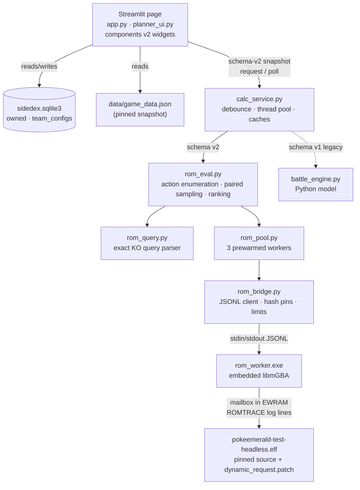

# Sidedex

Local Emerald Imperium Box and type-coverage planner with Pokedex and Calc tabs.

The current local plan for ROM-backed predictions and recommendations is in
[`CALC_PRODUCTION_PLAN.md`](CALC_PRODUCTION_PLAN.md); the evaluator request and
result contract is in [`CALC_CONTRACT.md`](CALC_CONTRACT.md). Calc uses the
pinned compiled engine for move queries and paired battle-turn estimates. These
results are not called ROM verified until a controlled release-ROM comparison
passes. The older Python model remains for legacy tests.

```powershell
python -m pip install -r requirements.txt
python app.py --self-check
streamlit run app.py
```

`--self-check` runs the party-cap and rollback checks and prints whether the
engine artifact and ROM worker are present. Without them the Pokedex tab works
normally and the Calc cards report `missing-artifact` with the setup step.

## Features

Browse trainers by gym or mapped location, inspect their teams and moves, and
manage your party and 14 visual PC Boxes on the same page. Each Box holds 30
Pokémon; use the game arrows to switch boxes and the Box field to move a Pokémon.
Party Pokémon use the same card style as trainer teams, with a player trainer
card for your profile. Select a Pokémon to see its details in a full-width panel
with stats on the left and moves on the right. Enemy team cards show whether the
selected Pokémon has an advantage, the matchup is even, or the enemy has the
advantage; unknown data gets a question mark. Use **Add Pokémon** to create a
record. Owned Pokémon are stored locally in `sidedex.sqlite3`.

The **Calc** tab shows ordered player and trainer teams around two focused
Pokémon panels. Click a compact card to focus it; use its change icon to choose
another Pokémon. Player slot changes update the actual party, while trainer slot
changes only reorder that trainer's display. The Box retains its hover preview,
but clicking a Box Pokémon does not change Calc focus. Named configs save the
party lineup, trainer, focus choices, display order, item switches, level cap
milestone, difficulty, and HP edits made in the focused panels. The focused
Pokémon on each side are the active battlers. New scenarios start at full
editable HP. Calc assumes no status, a clear field, no recorded turns, and
unknown RNG; it evaluates every legal player action. Current stat stages for the
two active Pokémon can be entered in their panels. Held-item switches apply to
both active Pokémon. Older configs preserve unknown HP, IVs, and EVs. A numeric
cap that has no ROM progression milestone shows a specific unsupported-context
message. Hard difficulty configs require an explicit Easy/Normal correction.

## System architecture

Sidedex is a single-user, offline Streamlit app. Everything runs on the local
machine: the UI process, a SQLite file, a read-only game-data snapshot, and a
small pool of native emulator processes that execute the game's own battle code.



| Layer | Files | Responsibility |
| --- | --- | --- |
| Entry and storage | `app.py` | SQLite schema, migrations, party/Box moves, config CRUD, engine prewarm, `--self-check` |
| Page | `planner_ui.py`, `ui.css` | Pokedex and Calc tabs, snapshot building, result-card rendering |
| Widgets | `*_component.py` | PC Box, Calc roster, focused build/profile, HP and status badges, config picker |
| Offline lookups | `sprite_assets.py`, `trainer_progression.py`, `matchup.py` | Icons as data URLs, trainer ordering, type-only matchups |
| Calc orchestration | `calc_service.py` | Non-blocking request/poll, debounce, cancellation, result caches |
| Compiled-engine evaluator | `rom_eval.py`, `rom_query.py` | Legal actions, seeds, batching, statistics, recommendation |
| Process management | `rom_pool.py`, `rom_bridge.py` | Worker lifecycle, identity checks, strict protocol parsing |
| Native worker | `native/rom_worker/` | libmGBA host with save/load state, EWRAM writes, batched turns |
| Engine hooks | `tools/rom_oracle/` | Patch for the pinned game source, ID map, trace tools, fixtures |
| Data tooling | `tools/extract_game_data.py`, `tools/import_pokemon_portraits.py`, `tools/build_ability_coverage.py` | Regenerate the snapshot and assets from a pinned checkout |
| Legacy model | `battle_engine.py` | Source-transcribed Python calculator used by legacy tests |

### Request lifecycle

1. Every rerun of the Calc tab builds a schema-v2 `BattleSnapshot` from the
   party, trainer, focus, HP edits, stat stages, item switches, milestone, and
   difficulty.
2. `calc_service.request()` hashes the snapshot and returns immediately. A
   0.35 s debounce timer drops superseded edits; the surviving key is submitted
   to a two-thread executor.
3. `rom_eval.evaluate()` checks out a booted worker from the pool, runs the
   exact move query, publishes those cards, then samples full turns and
   republishes refined cards as paired samples complete.
4. A `st.fragment(run_every=0.5)` in `planner_ui.py` polls `calc_service.poll()`
   and redraws only the result area. A result is shown only when its key matches
   the current snapshot, so stale results never render.

## Design choices

**Run the game's code instead of reimplementing it.** The first Calc was a
Python port of the battle formulas (`battle_engine.py`). It stayed exact only
for a narrow slice and each new mechanic needed a hand port. The current path
builds the pinned game source's headless battle-test ELF with a small hook
patch and runs it on an embedded mGBA core or, by default, on a native i386 build of the same
code (`sidedex-native`, verified byte-equal to the mGBA test ELF, see `ROM_NATIVE_PLAN.md` section 7). Damage, accuracy, abilities,
items, and the trainer AI all come from the compiled game code. Python only
builds requests, parses traces, and does statistics.

**Pin every identity.** The game source commit (`data/source_lock.json`), the
engine ELF SHA-256 (`rom_bridge.ENGINE_ELF_SHA256`, mirrored in
`tools/rom_oracle/pinned_source.json`), and the worker executable SHA-256
(`rom_bridge.WORKER_SHA256`) are checked at worker start and on every batch
reply. Any mismatch returns `artifact-mismatch` or `source-mismatch`, never a
number. The same identities are part of the Calc cache key, so rebuilding an
artifact invalidates old results.

**Fail closed with named reasons.** Unknown is never treated as zero. Every
card is either a result with an explicit evidence label (`engine-exact`,
`engine-fixed-seed`, `estimated`, or the reserved `verified-fixed-seed`) or
`unavailable` with a machine-readable reason. Errors are per card where
possible, so one unsupported move does not blank its siblings.

**Mailbox transport, not UI automation.** The patched test runner announces a
fixed-size request mailbox in EWRAM (`ROMTRACE|ready|<address>|<bytes>`). The
worker saves a state at that point. Each request is a packed binary mailbox
(`tools/rom_oracle/run_dynamic.py::encode_request`, source string IDs mapped
through `numeric_id_map.json`) that the worker writes into memory after
restoring the checkpoint. Results come back as `ROMTRACE|…` lines from mGBA's
debug logger. The worker keeps only the record types the evaluator parses, and
the bridge bounds frames, message size, batch size, and write range.

**Long-lived, prewarmed workers.** Booting the ELF to its mailbox is the
expensive step, so `rom_pool.EnginePool` keeps three booted workers, each with
its ready checkpoint in memory. `app.py` starts them in the background once per
server (`st.cache_resource`). A worker that errors or exits is discarded and
replaced on the next checkout. One evaluation holds one worker, and each worker
call runs up to eight candidate actions from the same checkpoint.

**Streamlit with isolated widgets.** Streamlit keeps the app a single Python
process with no separate frontend build. The interactive pieces (PC Box drag
and hover, roster editing, badges) are `st.components.v2` components with
inline HTML/JS, so clicks inside them do not trigger full-page reruns. Assets
are served from disk as data URLs, so the app needs no network connection.

**SQLite with invariants in the schema.** Two partial unique indexes enforce
one Pokémon per Box slot and per party slot. Writes use `BEGIN IMMEDIATE`, or a
savepoint when nested, so moves and swaps are atomic. `connect()` migrates
older databases in place: it adds missing columns and repairs invalid or
duplicate slot assignments before creating the indexes.

**Bounded latency.** Each evaluation has a ten-second deadline measured from
when the work starts. The exact move query is published first, typically well
under a second, and sampling refines behind it. A snapshot edit bumps the
current key, and the evaluator's guard aborts the old job at its next batch
boundary. Queued work is ignored rather than cancelled.

## Algorithms

### Exact move KO odds (query mode)

Before any turn resolves, the patched runner calls the engine's damage
calculation for each move of both active Pokémon at the pre-choice state and
emits `ROMTRACE|query|damage` records. For a single-hit move the KO fraction
enumerates all 16 damage-modifier rolls × critical/non-critical × accuracy, so
the denominator is `1600 × crit_denominator`. A full-HP Focus Sash or Sturdy
blocks the one-hit KO and is noted on the row.

For standard multi-hit moves the engine also emits the hit-count weights (for
example 7:7:3:3 over 2–5 hits) and the 16 per-hit rolls with and without a
critical hit. `rom_query._multi_hit_probability` convolves the per-hit damage
histogram once per hit count with exact `fractions.Fraction` arithmetic. With
Sash or Sturdy, the KO must land before the last hit, because the protected
target survives the first lethal hit at 1 HP. Other multi-hit effects and
nonstandard fixed-damage moves return `unsupported-mechanic` with their damage
range when available.

### Critical-hit policy

KO and faint risk exclude ordinary critical hits and keep critical effects that
come from enabled held items or abilities. The patch applies this inside the
game's `Cmd_critcalc`. It computes the crit stage both with and without the
attacker's ability and item, and blocks the crit when the two match. Every
trace carries `ROMTRACE|critical-policy|item-ability-only|battle-script-filtered`,
and the evaluator discards turns that lack it.

### Paired full-turn sampling

Each legal first action (every active move with PP left plus every switch to a
bench slot with HP above zero) is run as one complete turn against the real
trainer AI.

- **Common random numbers.** All actions for one sample use the same pair of
  four-word SFC32 states (main and secondary RNG streams). This pairing makes
  differences between actions far less noisy than independent draws. Seeds
  come from `random.Random` seeded with the SHA-256 of the snapshot, so the
  same scenario always replays the same samples.
- **Known versus unknown seed.** If both RNG streams are entered, exactly one
  deterministic turn per action is run and cards say `engine-fixed-seed`, not
  probability. Otherwise the target sample count is
  `min(16, max(3, affordable))`, where `affordable` assumes about 240 ms per
  turn and keeps one second in reserve.
- **Early stopping.** Sampling stops when the recommendation is no longer
  ranking-uncertain, or when the next sample would likely overrun the deadline
  (1.6 × the last sample's time + 0.5 s).
- **Floors.** Unknown-seed cards need at least three complete paired samples.
  Fewer returns `insufficient-samples`, never a zero-width interval. A timeout
  keeps cards that already have usable trajectories.

### Statistics

- Proportions (death risk, KO, KO-before-faint, AI action frequencies) use the
  Wilson 95% score interval, which stays well-behaved at 0 or n successes and
  small n.
- Each action also reports a score, the enemy HP lost minus player HP lost
  plus 100 per survivor advantage, with a normal-approximation interval
  (mean ± 1.96·SE). The score is informational; ranking uses the risk order
  below.
- A known seed reports a deterministic observation with `interval_95: null`.

### Follow-up estimate

After each first action's turn resolves, the evaluator runs a second query at
the resulting state (post-switch or after the candidate turn). From the
engine-exact rows it picks the best follow-up attack:

- **Turns to KO:** `ceil(target_hp / (mean(min, max damage) × accuracy))`.
- **Move order:** priority first, then computed Speed with stat stages. Speed
  order is treated as unknown for weather or terrain speed abilities, Unburden,
  Quick Feet, Slow Start, speed-changing held items, non-volatile status, or a
  speed-raising first move.
- **Survival:** for one enemy action, `1 − engine-exact enemy KO chance`. For
  more than one, survival counts as certain only if the maximum measured enemy
  hit times the number of enemy actions stays below current HP; otherwise it
  is unknown.
- **Viability:** probability of a KO before fainting when the damage path is
  decided by the roll range, otherwise unknown.
- **Matchup label:** each estimate is `estimated-stable`,
  `uncertain-speed-order`, `uncertain-multi-turn-survival`,
  `uncertain-damage-rolls`, or `unsupported-changing-effect`. Only stable
  matchups contribute a point follow-up risk.

### Recommendation ranking

Combined faint risk is
`first_turn_risk + (1 − first_turn_risk) × followup_risk`, with the range built
from the first-turn Wilson bounds and the modeled follow-up range. Modeled
ranges are not confidence intervals. Actions sort lexicographically by:

1. combined party faint risk (the upper bound when no point estimate exists);
2. KO-before-faint (follow-up viability when available);
3. estimated turns to KO;
4. remaining party HP fraction.

Every action whose risk range overlaps the leader's stays a leading option. The
recommendation is flagged `ranking_uncertain` with reasons such as
`overlapping-risk`, `insufficient-matchup`, `uncertain-followup-risk`, or
`switch-not-proven`. A switch is recommended uniquely only when its upper risk
bound is below the safest move's lower bound and it has a stable, viable KO
path. The AI-action card is the trainer's action distribution in the
trajectories of the planned action, or of the lowest-risk action when none is
planned. If the trainer has bag items, the recommendation is withheld
(`unsupported-mechanic`) because resolved turns do not re-run the AI's item
decision.

### Caching

- The cache key is the SHA-256 of the canonical snapshot JSON plus source,
  ELF, worker, and sampler identities, so any edit or rebuilt artifact misses.
- In memory: a 32-entry LRU of final results plus the latest partial per key.
- On disk: the last two completed ROM results in
  `native/rom_worker/build/calc_cache.json`, written atomically through a temp
  file and `os.replace`.
- A generation counter prevents jobs started before an `invalidate()` from
  writing into the cache.

### Pokedex matchups, level caps, and trainer order

- **Enemy advantage badges** (`matchup.py`) are type-only. They compare the
  best type effectiveness among known damaging moves in each direction; a
  higher outgoing best is an advantage, equal is even, and a missing build or
  type is unknown. `recommend_swaps` scores single-slot swaps from the live Box
  by enemies newly covered (a super-effective move or a resistance/immunity)
  minus enemies lost, with the reasons attached.
- **Level caps** replace a free number with the ROM progression milestones from
  `src/caps.c`. Selecting one simulates the ROM's `LevelBoxesToCap` on a copy of
  the party, assuming every member is unmarked; saved Box levels are never
  altered. The highest simulated party level resolves `200+n` scaled trainer
  levels, and affected trainers carry that rule in `context_required`.
- **Trainer order** (`trainer_progression.py`) ranks trainers by gym, rematch,
  and map chapter where the pinned trainer IDs and location data establish
  progression. Everything else sorts alphabetically under Other, and that order
  makes no encounter claim.

## Data pipeline and provenance

Trainer and matchup data comes from `data/game_data.json`. Location references
used by the trainer browser are in `data/trainer_locations.json`. Icon assets
are bundled locally; see `assets/README.md` for provenance and redistribution
notes, and `tools/import_pokemon_portraits.py` for the portrait importer.

The checked snapshot is generated from the pinned Emerald Imperium commit in
`data/source_lock.json`. To regenerate it from a local checkout at that exact
commit, run `python tools/extract_game_data.py PATH_TO_CHECKOUT`. The extractor
rejects other revisions and checks representative trainers and type data. It
resolves omitted trainer moves from the level-up learnset at battle level, uses
the pinned game's default nature and first ability, and reads trainer portrait
IDs, IVs, and EVs from the source tables. An omitted trainer IV/EV is not
unknown: the ROM applies the table's packed IV word unconditionally and leaves
EVs at zero, so the snapshot records those resolved values. The species picker
excludes source marker IDs and Shadow Lugia, whose numeric ID has no species
data initializer in the pinned build.

Soul Link constraints are not supported. The upstream fork has no root license
file at the pinned commit; confirm its terms before redistributing the
generated snapshot.

## Calc results and limits

The UI sends schema-v2 snapshots to the compiled-engine path described above.
For a supported battle-start trainer single, all four cards fill:

- **Move cards** report `engine-exact` KO fractions and damage ranges from the
  query.
- **AI action** shows trainer action probabilities from paired turns. A
  `B_ACTION_USE_ITEM` trainer choice appears as an `ai_actions` entry.
- **Recommendation** ranks every legal first action with a best follow-up.

A known-seed request is a deterministic preview, while an unknown-seed request
is an estimate with sample count and 95% interval. Recommendation cards
separate measured first-turn death risk from modeled follow-up risk and show
the combined ranking basis. Player bag actions are outside the current action
set. A built ROM or a running emulator alone does not establish prediction
accuracy, so `verified-fixed-seed` stays reserved for a result that also passes
a controlled release-ROM comparison.

Measured limits at this checkpoint: the 20-trainer local fixture sweep
(`python work/phase5_verification.py`, 10-second deadline per request) measured
a maximum 0.177 s for the exact query, 2.886 s to the first recommendation,
8.635 s for an unknown-seed final result, and 0.986 s for a known-seed final
result. All four exact-versus-sampled checks passed; detailed cases are in
`work/phase5_verification_results.json`.

Current constraints:

- The engine mailbox requires party slot 0 as active on both sides. Calc
  reorders the focused Pokémon into slot 0 (`assumed_lead`) and remaps switch
  slots; labels keep the original party index. Edited focused HP, status, and
  PP are accepted as `edited-start`.
- Easy or Normal difficulty, a real level-cap milestone, a clear field, and at
  most one replayed history turn are required. Anything else returns
  `unavailable` with a specific reason (`incomplete-state`, `invalid-id`,
  `unrepresentable-history`, `no-legal-actions`, `insufficient-samples`,
  `timeout`, `missing-artifact`, `artifact-mismatch`, `source-mismatch`,
  `engine-error`).
- Longer matchup estimates are limited to stable matchups; unsupported or
  changing effects remain labeled uncertain.
- The whole-battle calculation button, whole-battle win probability, doubles,
  and player bag actions remain unimplemented and are not claimed.

### Engine setup

1. Apply `tools/rom_oracle/dynamic_request.patch` to a disposable full checkout
   at the pinned source. The build recipe is `dynamic_oracle.recipe` in
   `tools/rom_oracle/pinned_source.json`.
2. Build `pokeemerald-test-headless.elf`. Its SHA-256 must equal
   `rom_bridge.ENGINE_ELF_SHA256` (currently `2186323F…`, hook protocol 9; query cards use its trace path, request flags bit0 clear).
3. Copy it to `native/rom_worker/build/mingw/pokeemerald-test-headless.elf`, or
   set `SIDEDEX_ENGINE_ELF_PATH`.
4. Build the worker with `native/rom_worker/build.ps1` (MSYS2 MinGW64; see
   `native/rom_worker/README.md`). Its hash is pinned in
   `rom_bridge.WORKER_SHA256`; set `SIDEDEX_ROM_WORKER_EXE` to use another
   path.

The recommendation card is `planner.plan` (open-loop UCT) over `rom_rollout.py`, which needs a v9 hook ELF:
`SIDEDEX_V9_ELF` (default: the pinned ELF path). `SIDEDEX_ENGINE=mgba` (default) rolls out on mGBA;
`SIDEDEX_ENGINE` unset picks `native` when the native i386 engine (`rom_native.NATIVE_BIN`, WSL
`/home/abj1/sidedex-native/sidedex-native`, sha256 pinned as `rom_identity.NATIVE_ENGINE_SHA256`) is reachable and matches
the pin, else `mgba` with a logged reason. Set `native` or `mgba` to force one. Query cards and the recommendation
both run on the chosen engine; native uses the fused `rollout` op (one call per worker per batch).
`SIDEDEX_NATIVE_CMD` overrides the launch command, `SIDEDEX_NATIVE_BIN` the Windows-visible binary path.
`SIDEDEX_WORKERS` sets the rollout pool size (mgba 3, native `max(1, cores - 2)`). `python bench.py` compares engines.

Set `SIDEDEX_ROM_PATH` only for the real-ROM checks. When a new ELF or worker is
built, update the pins in `rom_bridge.py` and `pinned_source.json` before
copying it into place. See `tools/rom_oracle/README.md` and `CALC_CONTRACT.md`.

## Tests

```powershell
python -m pip install pytest
python -m pytest -q
```

Unit tests cover storage and migrations (`test_storage.py`), UI helpers
(`test_calc_ui.py`), the service stream (`test_calc_service_stream.py`), the
bridge protocol (`test_rom_bridge.py`), the pool (`test_rom_pool.py`), query
parsing (`test_rom_query.py`), the evaluator (`test_rom_eval.py`), and the
legacy model. Live engine and worker tests skip when the pinned artifacts or
`SIDEDEX_ROM_PATH` are absent.

## Legacy Python model

Legacy tests compute the four result cards from a narrow Python model
transcribed from the pinned ROM source in `data/source_lock.json` (commit
`2576d0f3f4c861c760f0c55198e37e6d7b91683e`). Returned fractions are exact for
that model, but the model has not been checked against a running ROM. Nothing
is sampled in that model. The descriptions below document the legacy
calculation and its limits; they are not claims about current v2 output.

- **Your moves · KO probability / Enemy moves · KO probability** give the
  probability that the move knocks out the Pokémon that was active at the start
  of the turn, conditional on that move being selected (and, for the enemy
  card, on the player action you planned). Move failure, accuracy, critical
  hits, damage rolls and multi-hit counts are included. A move is gated on its
  own: an unsupported move is listed as unavailable with its reason while its
  siblings still show exact odds.
- **AI predicted action** is the distribution over the enemy trainer's legal
  actions (moves, switch destinations, bag items) for the entered battle state,
  summing to exactly 1. It is not conditioned on your planned move, because the
  ROM AI predicts from prior battle history.
- **Recommended action** is a **two-turn lookahead** over every legal
  first turn; after each observable outcome it picks the best legal second-turn
  action, scoring `sum(100*HP/maxHP)` over your team minus the enemy's, plus
  100 for each surviving Pokémon you have more than the enemy. Ties are all
  listed with their score breakdown. It is not a claim of whole-battle optimal
  play.

Percentages are `round(100 * num / den)` of an exact rational. Each result says
how it was obtained:

- **known-seed** — simulated from a saved four-word SFC32 RNG state;
- **seed-independent** — proven identical for every possible RNG state (for
  example a minimum damage roll already KOs);
- otherwise the card is **Unavailable** with a machine-readable reason such as
  `unknown-rng-seed`, `missing-input`, `unsupported-move`,
  `unsupported-ability`, `unsupported-item`, `unsupported-mechanic`,
  `unsupported-difficulty`, `conditional-party`, `unrepresentable-history`,
  `no-legal-actions`, `incomplete-search`, `timeout`, `source-mismatch` or
  `engine-error`, plus the missing input paths or the specific unsupported id.

A legacy card is exact only when every value it actually reads is known: level,
IVs, EVs, nature, ability, held item (or `Use Item` off for no item), current
and maximum HP, PP, status and stat stages for the active pair, the active
selections, the planned player action, the progression milestone and
Easy/Normal difficulty. Only Easy and Normal are offered, because the pinned ROM
has no Hard mode. Nonempty saved turn logs make the results unavailable because
the model does not implement seed conditioning from history. Bench HP/status
fields are needed only when a switch is actually reachable. For pinned ROM
data, an entered maximum HP that differs from the computed stat is rejected.

The legacy model's supported slice is singles with one active Pokémon per side,
physical/special damaging moves with a known effect and no recoil, secondary
effects, status moves or held items, abilities proven inert for the computed
paths, and the ordinary `AI_FLAG_CHECK_BAD_MOVE` trainer logic plus trainers
with no AI flags. Reachable AI switching remains unsupported. The pinned
trainer table carries no bag items (every entry is `ITEM_NONE`), so the ported
trainer-item path cannot be reached with the shipped data.

The arithmetic is transcribed from cited `src/...:line` locations, hand-derived
expectations live in `data/rom_fixtures.json` with their provenance, and
`test_battle_engine.py`, `test_rom_source.py`, `test_calc_ui.py` and
`test_calc_integration.py` check the ports against those fixtures. One valid
Haley/Rookidee fixture fills all four cards in 0.42 ms on this machine; this is
a model check, not a ROM oracle or broad performance benchmark.
